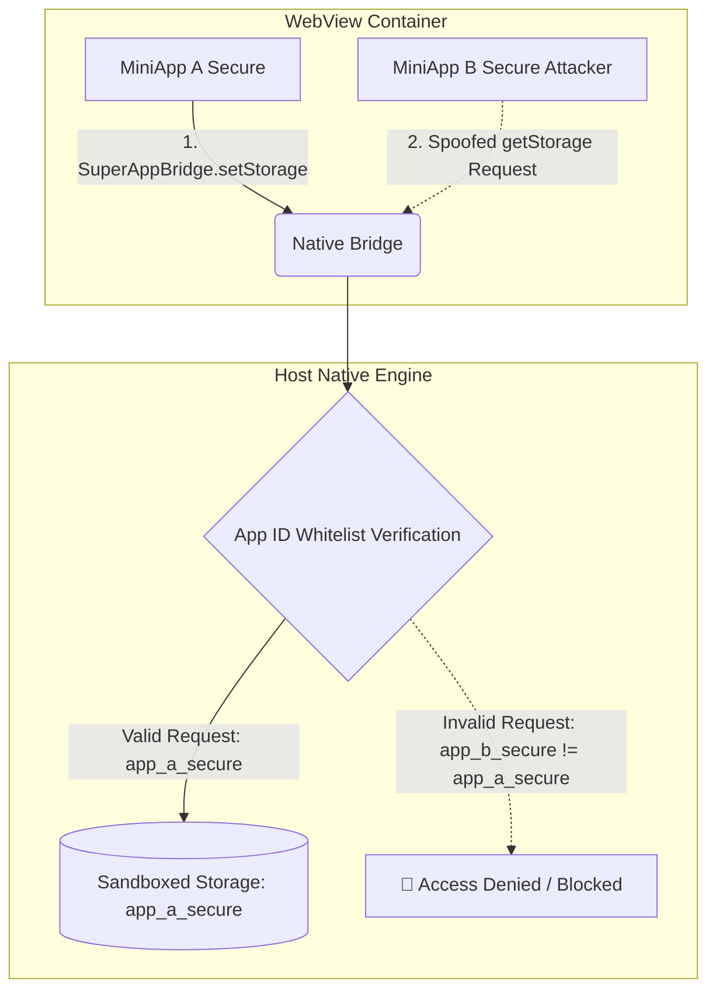

# SuperApp & MiniApp Security Sandbox PoC

안드로이드 WebView 환경에서 발생하는 로컬 파일(`file://`) 보안 취약점과 이를 방어하기 위한 **상용 미니앱(WeChat, Kakao 등) 방식의 보안 샌드박스(Sandbox) 아키텍처**를 실습 및 검증하는 개념 증명(PoC) 프로젝트입니다.

---

## 📌 목차
1. [프로젝트 개요](#프로젝트-개요)
2. [보안 문제점 및 취약점 (SOP 붕괴)](#보안-문제점-및-취약점-sop-붕괴)
3. [해결 방안: 네이티브 브릿지 샌드박스](#해결-방안-네이티브-브릿지-샌드박스)
4. [미니앱 구성 요소](#미니앱-구성-요소)
5. [시큐어 코딩 가이드라인 (Secure Coding Guidelines)](#시큐어-코딩-가이드라인-secure-coding-guidelines)
6. [시작하기](#시작하기)

---

## 💡 프로젝트 개요
슈퍼앱(SuperApp) 호스트 내에서 돌아가는 웹 기반 미니앱(MiniApp) 환경은 편리하지만, 로컬 파일(`file://`) 기반 렌더링 시 **동일 출처 정책(Same-Origin Policy, SOP)이 무력화**되는 심각한 보안 결함이 존재합니다.

본 프로젝트는:
* 브라우저 기본 웹 저장소(`document.cookie`) 사용 시 발생하는 데이터 탈취 위험성을 시연하고,
* **Native Bridge**와 **App ID 기반 데이터 격리(Sandbox)**를 적용하여 보안 위협을 원천 차단하는 구조를 실증합니다.

---

## 🚨 보안 문제점 및 취약점 (SOP 붕괴)

안드로이드 WebView 환경에서 `setAcceptFileSchemeCookies(true)` 및 로컬 파일(`file://`) 스킴을 사용할 경우, 시스템은 모든 로컬 HTML 파일들을 **동일한 출처(Same Origin)**로 취급합니다.

1. **SOP(동일 출처 정책) 무력화**: `assets/miniapp_a/index.html`과 `assets/miniapp_B_secure/index.html`이 서로 같은 출처로 인식됨.
2. **쿠키 및 WebStorage 공유**: 특정 미니앱이 `document.cookie`에 저장한 세션 토큰이 기기 내 모든 미니앱에게 평문 노출됨.
3. **쿠키 삭제 메커니즘의 한계**: 미니앱 종료 시 쿠키를 지우더라도, 멀티태스킹/동시 실행 상황이나 비정상 종료 시 탈취 위험을 완전히 막을 수 없음.

---

## 🛡️ 해결 방안: 네이티브 브릿지 샌드박스

상용 슈퍼앱 플랫폼 아키텍처를 모방하여 **웹 브라우저의 저장소를 신뢰하지 않고, 네이티브(Flutter/Android)가 저장 및 권한을 통제**합니다.



* **웹 브라우저 저장소 금지**: `document.cookie`, `localStorage` 사용을 배제.
* **Native Bridge 호출**: 모든 데이터 저장/조회는 `SuperAppBridge.setStorage` / `getStorage`를 통해서만 수행.
* **App ID 기반 권한 검증**: 네이티브 레이어에서 요청자의 `App ID`와 소유자의 `App ID`를 대조하여 다른 미니앱의 데이터 접근을 즉시 차단.
* **CSP(Content Security Policy) 적용**: 외부 악성 스크립트 실행 및 인라인 스크립트 남용 차단.

---

## 📱 미니앱 구성 요소

| 미니앱 명 | 유형 | 설명 |
| :--- | :--- | :--- |
| **미니앱 A (쿠키 생성)** | `[취약]` | 브라우저 기본 방식(`document.cookie`)으로 세션 쿠키를 생성합니다. (SOP 무력화로 탈취 대상이 됨) |
| **미니앱 A (Secure)** | `[보안]` | `App()`, `Page()` 생명주기 훅을 사용하며, **Native Bridge**를 통해 네이티브 격리 공간에 데이터를 안전하게 저장합니다. |
| **미니앱 B (Secure Attack)** | `[공격자]` | 샌드박스의 방어력을 테스트하는 공격자 앱입니다.<br>1) `document.cookie` 조회 (쿠키 미사용 검증)<br>2) `SuperAppBridge`를 통해 타 앱(`app_a_secure`) 데이터 무단 요청 (네이티브 차단 검증) |

---

## 🔐 시큐어 코딩 가이드라인 (Secure Coding Guidelines)

### 1. 🛡️ 슈퍼앱 호스트 엔진 (Android/Native 개발자)
* **WebView 로컬 파일 보안 설정 제한**: `setAcceptFileSchemeCookies(true)` 등 취약한 옵션 사용 금지. `WebViewAssetLoader` 사용 권장.
* **Native Bridge 요청자(Caller) Identity 검증**: JS가 전달하는 App ID를 맹신하지 말고, 네이티브 단에서 브릿지 호출 주체의 실체(Context/App ID)를 직접 대조·검증할 것.
* **미니앱별 데이터 물리적/논리적 격리**: `App ID`별로 네이티브 저장 공간(EncryptedSharedPreferences, Room SQLCipher 등)을 세분화하여 저장.

### 2. 🔐 미니앱 (웹/JavaScript 개발자)
* **웹 표준 저장소 민감 정보 저장 금지**: WebView 환경에서 `document.cookie`, `localStorage`에 토큰이나 개인정보(PII) 저장 절대 금지.
* **플랫폼 제공 Native Bridge SDK 사용**: 데이터 저장 및 통신 시 반드시 호스트 슈퍼앱이 검증하여 제공하는 Native Bridge API 이용.
* **CSP(Content Security Policy) 적용**: `<meta http-equiv="Content-Security-Policy" ...>`로 외부 및 무단 스크립트 실행 제한.

---

## 🚀 Requirements & Quick Start

### Requirements
- Flutter 1.12.13 이상
- Node v12.14.0 이상
- Android Studio AVD 또는 실물 기기

### Build Framework
```bash
NODE_ENV=production npx parcel build miniapp_framework.js
```
