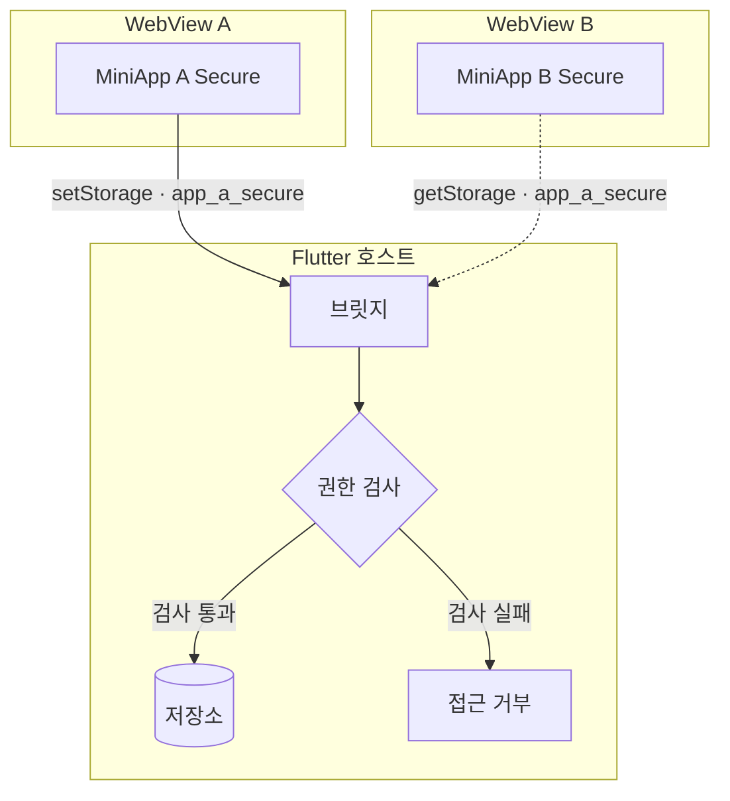

# SuperApp & MiniApp Security Sandbox PoC

안드로이드 WebView 환경에서 발생하는 로컬 파일(`file://`) 보안 취약점과 이를 방어하기 위한 **상용 미니앱(WeChat, Kakao 등) 방식의 보안 샌드박스(Sandbox) 아키텍처**를 실습 및 검증하는 개념 증명(PoC) 프로젝트입니다.

---

## 📌 목차
1. [프로젝트 개요](#프로젝트-개요)
2. [보안 문제점 및 취약점](#보안-문제점-및-취약점)
3. [해결 방안: 네이티브 브릿지 샌드박스](#해결-방안-네이티브-브릿지-샌드박스)
4. [미니앱 구성 요소](#미니앱-구성-요소)
5. [시큐어 코딩 가이드라인 (Secure Coding Guidelines)](#시큐어-코딩-가이드라인-secure-coding-guidelines)


---

## 💡 프로젝트 개요
- 파일 스킴 쿠키를 허용한 환경에서 미니앱 간 쿠키 공유 위험 재현
- Native Bridge의 setStorage / getStorage API 구현
- App ID별 인메모리 데이터 구분 및 요청 권한 검사
- 다른 미니앱의 App ID를 전달하는 데이터 조회 시나리오 검증
본 프로젝트에서 샌드박스는 호스트가 관리하는 저장소와 접근 검사로 구성한 논리적 데이터 격리 구조를 의미합니다. 검증 범위는 쿠키 공유와 브릿지 저장소 접근 제어입니다.

---

## 🚨 보안 문제점 및 취약점

Android WebView에서 파일 스킴(file://) 쿠키를 허용하면, 같은 쿠키 저장소를 사용하는 로컬 미니앱 사이에서 쿠키가 공유될 수 있습니다.

1. **미니앱 간 쿠키 공유**
파일 스킴 쿠키를 허용하면 같은 쿠키 저장소를 사용하는 미니앱 사이에서 세션 토큰 등 민감한 정보가 노출될 수 있습니다.

2. **불완전한 App ID 검증**
요청자가 전달한 App ID를 경로의 부분 문자열로 검사하므로, 빈 문자열이나 공통 문자열을 이용한 요청이 권한 검사를 통과할 수 있습니다.

3. **브릿지 호출 주체 식별의 한계**
미니앱의 에셋 경로를 기준으로 권한을 검사하여, iframe이나 이동한 페이지에서 브릿지를 호출하는 상황을 정확히 구분하기 어렵습니다.

4. **인라인 스크립트 실행 허용**
CSP에 'unsafe-inline'이 포함되어 있어, HTML에 악성 스크립트가 삽입되면 실행될 위험이 있습니다.

---

## 🛡️ 해결 방안

상용 슈퍼앱 플랫폼 아키텍처를 모방하여 **웹 브라우저의 저장소를 신뢰하지 않고, 네이티브(Flutter/Android)가 저장 및 권한을 통제**합니다.



Flutter 호스트는 요청에 담긴 App ID를 각 WebView에 지정된 미니앱의 에셋 경로와 비교합니다. A의 저장 요청은 통과해 App ID별 메모리 저장소에 기록되고, B의 조회 요청은 거부됩니다.

* **호스트 메모리 저장소 사용**: `localStorage`에 기록하는 대신 Flutter 호스트의 메모리 저장소에 보관
* **Native Bridge 호출**: 모든 데이터 저장/조회는 `SuperAppBridge.setStorage` / `getStorage`를 통해서만 수행.
* **App ID 기반 권한 검증**: 네이티브 레이어에서 요청자의 `App ID`와 소유자의 `App ID`를 대조하여 다른 미니앱의 데이터 접근을 즉시 차단.
* **CSP(Content Security Policy) 적용**: 외부 악성 스크립트 실행 및 인라인 스크립트 남용 차단.

---

## 📱 미니앱 구성 요소

| 미니앱 명 | 유형 | 설명 |
| :--- | :--- | :--- |
| **미니앱 A (쿠키 생성)** | `[취약]` | 브라우저 기본 방식(`document.cookie`)으로 세션 쿠키를 생성합니다. |
| **미니앱 A (Secure)** | `[보안]` | `App()`, `Page()` 생명주기 훅을 사용하며, **Native Bridge**를 통해 네이티브 격리 공간에 데이터를 안전하게 저장합니다. |
| **미니앱 B (Secure Attack)** | `[공격자]` | 샌드박스의 방어력을 테스트하는 공격자 앱입니다.<br>1) `document.cookie` 조회 (쿠키 미사용 검증)<br>2) `SuperAppBridge`를 통해 타 앱(`app_a_secure`) 데이터 무단 요청 (네이티브 차단 검증) |

---

## 🔐 시큐어 코딩 가이드라인 (Secure Coding Guidelines)

### 1. 🛡️ 슈퍼앱 호스트 엔진 (Android/Native 개발자)
- **로컬 콘텐츠와 출처 정책 관리**
WebViewAssetLoader를 통한 HTTPS 기반 로컬 콘텐츠 로딩을 검토합니다. 미니앱별 출처 구성, 저장소 접근 권한, 파일 접근 설정을 함께 관리합니다.

- **호스트가 결정하는 호출자 식별자 사용**
호스트가 각 미니앱 실행 컨텍스트에 신뢰할 수 있는 App ID를 연결합니다. 브릿지 요청의 권한은 이 식별자를 기준으로 결정하고, JavaScript가 전달한 대상 App ID가 호출자에게 허용된 범위인지 정확히 검사합니다.

- **요청 검증과 접근 거부 처리**
JSON 형식, 지원하는 action, App ID, key와 value의 자료형·길이를 검증합니다. 빈 식별자와 알 수 없는 식별자를 거부하고, 권한 검사를 통과한 요청에 대해서만 저장소 작업을 수행합니다. 권한 거부 시 후속 처리를 종료하고 정해진 오류 응답을 반환합니다.

- **브릿지 노출과 페이지 이동 제한**
필요한 네이티브 기능만 노출합니다. 사용하는 브릿지 API의 출처·프레임 검증 기능을 확인하고, 외부 페이지 이동과 iframe 로딩을 허용 목록으로 관리합니다. 민감한 브릿지는 신뢰할 수 있는 콘텐츠에 한정하여 제공합니다.

- **저장소와 민감 데이터 관리**
조회뿐 아니라 저장·수정·삭제에도 미니앱별 권한 검사를 적용합니다. 영구 저장이 필요한 경우 민감도에 맞는 암호화와 키 관리를 설계합니다. 로그에는 토큰 원문을 제외한 요청 식별 정보와 처리 결과를 기록합니다.

- **미니앱 콘텐츠의 신뢰성 확인**
외부에서 미니앱 패키지를 받는 구조로 확장할 경우, 배포 주체와 패키지 무결성을 확인한 뒤 호스트 권한을 부여합니다. 미니앱이 수정할 수 있는 CSP와 JavaScript 설정에 의존하는 통제에는 호스트 측 검증을 함께 적용합니다.

### 2. 🔐 미니앱 (웹/JavaScript 개발자)
- **민감 데이터의 저장 경로 지정**
본 PoC의 보안 구성에서는 민감한 테스트 토큰을 호스트의 저장 API로 관리합니다. 일반 웹 저장소에는 민감도와 출처 공유 범위를 검토한 데이터만 보관합니다.

- **입력값 검증과 안전한 화면 출력**
외부 입력과 저장소에서 읽은 값을 검증합니다. 일반 텍스트를 화면에 표시할 때는 textContent 등 텍스트 출력 API를 사용합니다. HTML 렌더링이 필요한 경우에는 신뢰할 수 있는 정제 처리를 적용합니다.

- **CSP 허용 범위 축소**
필요한 스크립트와 통신 대상만 허용합니다. 인라인 스크립트를 외부 파일로 옮기거나 nonce·hash 기반 정책을 검토하고, 'unsafe-inline'을 줄인 뒤 정상 기능과 차단 동작을 확인합니다.

- **브릿지 응답과 오류 처리**
권한 거부와 저장 실패를 명시적으로 처리합니다. 반환된 데이터를 출력하거나 후속 요청에 사용하기 전에 형식과 요청 연관성을 확인합니다.
---

## 🚀 Requirements & Quick Start

### Requirements
- Flutter 1.12.13 이상
- Node v12.14.0 이상
- Android Studio AVD 또는 실물 기기

### Build Framework
```bash
NODE_ENV=production npx parcel build miniapp_framework.js
```
